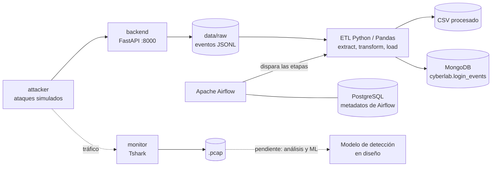

# NTRY: laboratorio de ingeniería de datos en ciberseguridad

NTRY es un laboratorio personal, basado en contenedores Docker, para entender el ciclo de vida de un evento de seguridad: cómo se genera, se registra, se procesa, se almacena y se analiza. La lógica es la misma que hay detrás de un SIEM, construida pieza por pieza para comprender cada etapa.

> **Estado: en desarrollo.** Proyecto educativo y experimental. No está diseñado para producción, y los ataques simulados deben ejecutarse únicamente contra los servicios de este laboratorio.

## Estado actual

| Funciona hoy | En diseño |
|---|---|
| Entorno reproducible con Docker Compose | Modelo de machine learning para detección |
| Backend FastAPI que registra eventos de autenticación en JSONL | Análisis del tráfico capturado (hoy solo se captura) |
| Generador de ataques simulados (`attacker`) | Reglas de detección adicionales (ver tabla) |
| Captura de tráfico con Tshark a archivos `.pcap` | Pruebas automatizadas del pipeline |
| ETL en Python y Pandas: lectura, validación, normalización y `event_id` | Tareas de Airflow independientes con reintentos |
| Carga a CSV y a MongoDB (base `cyberlab`, colección `login_events`) | Generador de tráfico legítimo para medir falsos positivos |
| Airflow que dispara las tres etapas del ETL en secuencia | |
| Análisis de secretos con Gitleaks en GitHub Actions | |

## Arquitectura



Las líneas punteadas son partes que aún no están conectadas de extremo a extremo. Todos los servicios corren en una red Docker aislada (`cyberlab_net`).

## Componentes

| Servicio | Rol |
|---|---|
| `attacker` | Genera solicitudes y simula actividad de autenticación contra el backend |
| `backend` | API FastAPI (puerto `8000`) que procesa logins y registra cada evento |
| `monitor` | Captura tráfico de red con Tshark (capacidades `NET_ADMIN` y `NET_RAW`) y guarda `.pcap` en `monitor/captures` |
| `etl` | Módulos de extracción, transformación y carga de los eventos |
| `airflow-*` | Webserver (`:8080`), scheduler e inicialización, con `LocalExecutor` |
| `postgres` | Base de datos de metadatos de Airflow (PostgreSQL 15) |
| `mongodb` | Almacenamiento documental de eventos (puerto `27017`) |

Elegí Tshark por portabilidad: funciona por línea de comandos dentro del contenedor y no requiere interfaz gráfica.

## Pipeline de datos

1. **Extract:** lee los eventos JSONL generados por el backend. Cada línea es un evento independiente.
2. **Transform:** con Pandas valida campos obligatorios, descarta registros vacíos o inválidos, normaliza marcas de tiempo, deriva fecha, hora y día de la semana, agrupa intentos por IP y usuario, y genera un `event_id` con SHA-256.
3. **Load:** guarda los datos en CSV y en MongoDB, con un índice único sobre `event_id` para evitar duplicados.

La orquestación está en el DAG `ntry_etl_pipeline`, que hoy ejecuta las tres etapas en secuencia.

<!-- TODO (Tomás): pega aquí un evento real de data/raw y cómo queda después del ETL (antes y después). Es la parte que mejor explica el proyecto. -->

## Detección de actividad sospechosa

La detección actual es por **reglas heurísticas de laboratorio**, no una detección definitiva de amenazas. Los umbrales son puntos de partida que se calibran contra tráfico legítimo.

| Escenario | Regla inicial | Ventana | MITRE ATT&CK | Estado |
|---|---|---|---|---|
| Fuerza bruta | 10 o más logins fallidos de una IP contra el mismo usuario | 5 min | T1110.001 | Umbral implementado; ventana de tiempo pendiente |
| Fuerza bruta de alto volumen | 50 o más logins fallidos de una IP | por definir | T1110 | Umbral implementado; ventana pendiente |
| Password spraying | 10 o más fallos de una IP contra 5 o más usuarios distintos | 10 min | T1110.003 | Planeado |
| Posible compromiso | Login exitoso tras 5 o más fallos de la misma IP | 10 min | T1110 / T1078 | Planeado |
| Volumen anómalo (posible DoS) | 50 o más peticiones por IP, sin importar si el login falla | 1 min | T1498 | Planeado |

Limitaciones conocidas: varias personas detrás de una misma IP (NAT) o un usuario que olvida su clave pueden activar falsos positivos, y los eventos provienen de un atacante propio, por lo que el modelo no debe validarse solo con ellos.

## Hoja de ruta de machine learning

1. **Línea base con reglas:** calcular variables por IP y ventana de tiempo (fallos, usuarios distintos, intervalo entre intentos, hora del día, éxito tras fallos).
2. **Generador de tráfico legítimo:** simular usuarios normales y usuarios que se equivocan de clave, para medir falsos positivos.
3. **Detección de anomalías no supervisada** (por ejemplo, Isolation Forest) y comparación contra las reglas.
4. **Modelo supervisado**, solo cuando existan ejemplos benignos y de ataque, evaluado con precisión y recall sobre datos de prueba separados.
5. **Análisis del tráfico `.pcap`** como fuente adicional de variables.

## Cómo ejecutarlo

Requisitos: Docker, Docker Compose y Git.

```bash
git clone https://github.com/T0M1B3T4/NTRY.git
cd NTRY
cp .env.example .env
# Edita .env con tus propios valores; nunca lo subas a Git
docker compose up -d --build
docker compose ps
```

Variables de entorno (ver `.env.example`):

| Variable | Uso |
|---|---|
| `POSTGRES_USER`, `POSTGRES_PASSWORD`, `POSTGRES_DB` | Base de datos de metadatos de Airflow |
| `MONGO_URI` | Conexión a MongoDB desde Airflow |
| `AIRFLOW_ADMIN_*` | Usuario administrador inicial de Airflow |

Accesos locales: backend en `http://localhost:8000` (documentación en `/docs`) y Airflow en `http://localhost:8080`.

Lanzar un ataque simulado y revisar el resultado:

```bash
docker compose exec attacker python attack.py
docker compose exec mongodb mongosh cyberlab --eval 'db.login_events.find().limit(5)'
```

<!-- TODO (Tomás): confirma estos dos comandos (argumentos de attack.py, nombre de la colección) y agrega cómo ejecutar el DAG desde Airflow. -->

## Seguridad

Prácticas aplicadas en el proyecto:

- Configuración mediante variables de entorno, con `.env` excluido del repositorio.
- Análisis de secretos con Gitleaks en GitHub Actions (`.github/workflows/security.yml`).
- Desarrollo en la rama `develop` y promoción a `main` tras revisión.

Este laboratorio es intencionalmente simple y **no debe exponerse a internet**:

- MongoDB no tiene autenticación configurada en el contenedor y publica el puerto `27017`.
- Airflow publica el puerto `8080`.
- Algunas imágenes no tienen versión fija (por ejemplo, `mongo:latest`).

Mejoras previstas: autenticación en MongoDB, publicar puertos solo en `127.0.0.1` y fijar versiones de imágenes.

## Tecnologías

Docker, Docker Compose, Python, FastAPI, Pandas, Tshark, MongoDB, PostgreSQL, Apache Airflow, GitHub Actions y Gitleaks.

## Autor

Tomás Betancur Delgado · [GitHub](https://github.com/T0M1B3T4)
